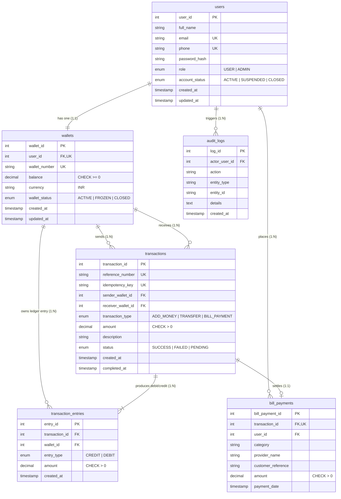

# WalletWise RDBMS Entity-Relationship (ER) Documentation & Architecture

## 1. Overview
The **WalletWise** digital wallet management system relies on a fully normalized (3NF/BCNF) relational schema designed for financial accuracy, non-negative balance constraints, atomic fund movements, and double-entry transaction integrity.

---

## 2. Mermaid Entity-Relationship (ER) Diagram

---

## 3. Relational Cardinalities & Constraints

| Relationship | Cardinality | Primary / Foreign Keys | Description |
| :--- | :--- | :--- | :--- |
| **users -> wallets** | 1 : 1 | `users.user_id` -> `wallets.user_id` (UNIQUE) | Strict 1:1 pairing. Each registered user receives a unique wallet account. |
| **wallets -> transactions** | 1 : N | `wallets.wallet_id` -> `transactions.sender_wallet_id` / `receiver_wallet_id` | A wallet can be the sender (debit origin) or receiver (credit destination) for multiple transactions. |
| **transactions -> transaction_entries** | 1 : N | `transactions.transaction_id` -> `transaction_entries.transaction_id` | Double-entry bookkeeping: ADD_MONEY creates 1 CREDIT entry; TRANSFER creates 1 DEBIT and 1 CREDIT entry; BILL_PAYMENT creates 1 DEBIT entry. |
| **transactions -> bill_payments** | 1 : 0..1 | `transactions.transaction_id` -> `bill_payments.transaction_id` (UNIQUE) | Only transactions of type `BILL_PAYMENT` generate a bill payment metadata record. |
| **users -> audit_logs** | 1 : N | `users.user_id` -> `audit_logs.actor_user_id` (NULLABLE) | Tracks administrative logins, configuration changes, transfers, and security events. |

---

## 4. Normalization Breakdown

1. **First Normal Form (1NF)**:
   - All attributes are atomic (no multivalued arrays or nested objects).
   - Each table has an explicit Primary Key.
   - Distinct column names with rigid data types (`DECIMAL(15,2)` for financial values, timestamps for event sequencing).

2. **Second Normal Form (2NF)**:
   - Satisfies 1NF.
   - All non-key attributes are fully functionally dependent on the entire primary key (no composite partial dependencies).

3. **Third Normal Form (3NF)**:
   - Satisfies 2NF.
   - No transitive dependencies ($X \rightarrow Y \rightarrow Z$). Non-key attributes (e.g. `user_id`, `wallet_id`, `transaction_type`) depend exclusively on the candidate key.

4. **Boyce-Codd Normal Form (BCNF)**:
   - For every functional dependency $X \rightarrow Y$, $X$ is a super key.
